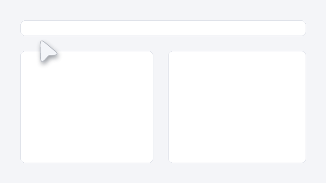

# vm-mcp — Remote Windows VM Control + AI Computer Use via MCP  `v3.0`

A Python MCP server that runs on a Windows machine and lets any MCP client (Kiro CLI, Claude Desktop, your local
AI…) run commands **and see/operate the desktop** with a visible, animated AI cursor.



```
 AI client ──HTTPS/SSE──▶ MCP server (service, Session 0) ──localhost──▶ Desktop agent (user's desktop)
                           66 tools                                      ├─ AI cursor overlay (90 fps)
                           shell/files/registry/…                        ├─ real mouse + keyboard (SendInput)
                                                                         └─ screenshots / UI tree
```

## Quick Start

On the VM (run as Administrator): `Set-ExecutionPolicy Bypass -Scope Process; .\install.ps1`
(no admin / own PC: `.\install-local.ps1 -StartNow`). Behind NAT? `.\tunnel.ps1` gives a public URL.

Add to your MCP client (`~/.kiro/settings/mcp.json` or equivalent):
```json
{ "mcpServers": { "vm-mcp": { "url": "http://<VM-IP>:8765/sse", "headers": { "X-Api-Key": "<key-from-install>" } } } }
```
Someone must be logged in on the VM console for computer use (it needs a desktop).

## Computer use — 14 tools

Workflow for the AI: **screenshot → act → screenshot**. Every coordinate is a pixel of the latest full screenshot.

| Tool | What it does |
|------|--------------|
| `screenshot` | Image of the screen. `grid=True` labels coordinates; `region=[x,y,w,h]` zooms; `hide_cursor` |
| `screen_info` | Text-only: screen size, cursor, front window, window list |
| `ui_tree` | Accessibility tree of the front window with exact click centres (works without vision) |
| `mouse_move` | Glide to x,y (hover) |
| `mouse_click` | left/right/middle, 1–3 clicks, optional modifiers (`["ctrl"]`) |
| `mouse_drag` | Press at A, move to B (optional waypoints), release |
| `mouse_hold` | Press and hold for N seconds |
| `mouse_button` | Low-level `down` / `up` for custom gestures |
| `mouse_scroll` | up/down/left/right, N notches |
| `keyboard_type` | Type text (Unicode-safe), optional Enter |
| `keyboard_key` | `enter`, `ctrl+a`, `alt+f4`, `ctrl+a ctrl+c` … with `repeat` |
| `window_focus` | Bring a window to front by title |
| `wait` | Pause with a "thinking" cursor pulse |
| `cursor_control` | status / show / hide / test the overlay |

The cursor is soft white and tints by action (blue click, violet right-click, teal double-click, amber drag/hold,
sky scroll, mint typing, lavender wait, coral error). Details: [docs/CURSOR.md](docs/CURSOR.md).
How it works: [docs/ARCHITECTURE.md](docs/ARCHITECTURE.md).

## Other tools (52)

| Family | Tools |
|---|---|
| Shell | `shell_run` `shell_run_elevated` `shell_run_bg` `shell_run_interactive` |
| Files | `file_read` `file_write` `file_delete` `file_list` `file_copy` `file_move` `file_hash` `archive_create` `archive_extract` |
| Processes | `process_list` `process_start` `process_kill` |
| Clipboard | `clipboard_get` `clipboard_set` |
| Registry | `registry_read` `registry_write` `registry_delete` `registry_list` |
| Services & tasks | `service_status` `service_control` `service_list` `scheduled_task_list` `scheduled_task_run` |
| Network | `net_info` `net_ping` `net_port_scan` `net_connections` `firewall_rule_list` `firewall_rule_add` `firewall_rule_remove` |
| System | `vm_info` `event_log_read` `env_get` `env_set` `installed_drivers` `toast_notify` |
| Software | `winget_install` `winget_search` `winget_list` `download_file` `install_msi` |
| Server | `server_version` `server_update` `server_restart` `server_log_tail` |
| Power | `reboot` `reboot_cancel` `shutdown` |

### Removed in v3.0
`screenshot` (old PowerShell version, blank from Session 0), `mouse_*`/`keyboard_*` (pyautogui versions) and all
`ai_*` tools (one PowerShell process per mouse move, 0.5–1.5 s each) — replaced by the 14 tools above, now backed by
one persistent desktop agent (~1 ms per input event). `ai_cursor.py` (Tk overlay) is replaced by the layered-window overlay.

---

## Self-Update

The server can update itself without touching the VM:

```
# From Kiro CLI — one-shot update + restart:
server_update(restart=True)

# Or two steps:
server_update()           ← downloads + unpacks new src/
server_restart()          ← re-execs the process with new code
```

`server_update` downloads the GitHub repo zip and replaces the whole `src/` tree (server.py + `vmmcp/` package).
The default URL is the `master` archive: `https://github.com/ketw/vm-mcp/archive/refs/heads/master.zip`.
Override it with `VM_MCP_UPDATE_URL`. The desktop agent is restarted automatically.

---

## Security

| Feature | Detail |
|---------|--------|
| API key | `X-Api-Key` header on every request (set via `VM_MCP_API_KEY`) |
| IP allowlist | `VM_MCP_ALLOWED_IPS=1.2.3.4,10.0.0.0/8` (optional) |
| Rate limit | `VM_MCP_RATE_LIMIT=60` requests/minute per IP (0 = off) |
| Health probe | `/health` and `/ping` require no auth |

---

## Network Options

| Option | Setup |
|--------|-------|
| Port forwarding | Forward TCP 8765 on router → VM local IP |
| **ngrok** (recommended for VMware NAT) | `.\tunnel.ps1 -AuthToken <token>` |
| Tailscale (best persistent) | Install Tailscale on both machines, use Tailscale IP |
| ZeroTier | Similar to Tailscale |

---

## Environment Variables

| Variable | Default | Description |
|----------|---------|-------------|
| `VM_MCP_API_KEY` | *(required)* | Secret API key |
| `VM_MCP_PORT` | `8765` | Listening port |
| `VM_MCP_HOST` | `0.0.0.0` | Bind address |
| `VM_MCP_SHELL_TIMEOUT` | `120` | Default shell timeout (seconds) |
| `VM_MCP_ALLOWED_IPS` | *(all)* | Comma-separated IP/CIDR allowlist |
| `VM_MCP_RATE_LIMIT` | `0` | Max requests/minute per IP (0=off) |
| `VM_MCP_UPDATE_URL` | GitHub master zip | Repo zip used by server_update() |
| `VM_MCP_AGENT_PORT` | `8788` | Localhost port of the desktop agent |
| `VM_MCP_SCREENSHOT_MAX_WIDTH` | `1920` | Screenshots wider than this are downscaled |
| `VM_MCP_AUTO_SCREENSHOT` | `0` | `1` = every mouse/keyboard tool also returns a screenshot |
| `VM_MCP_LOG` | `<install_dir>/vm-mcp.log` | Log file path |

---

## Manual Run

```powershell
cd vm-mcp\src
pip install -r requirements.txt
$env:VM_MCP_API_KEY = "my-secret-key"
python server.py
```

---

## File Structure

See **[AGENTS.md](AGENTS.md)** for the full map. In short:

```
src/server.py            entry point            src/vmmcp/tools/      one file per tool family
src/vmmcp/computer/      cursor + vision + input   docs/               ARCHITECTURE.md, CURSOR.md
assets/cursor/           cursor.svg + previews     tests/               python -m unittest discover -s tests -v
```
